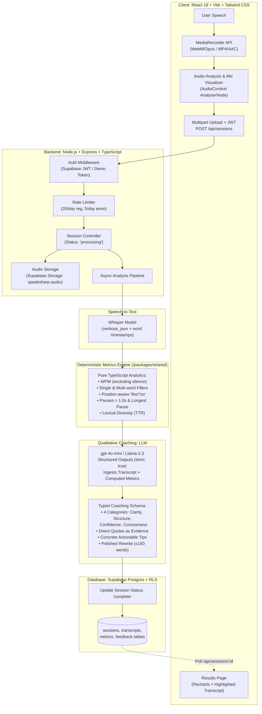

# SpeakSharp 🎙️⚡

> **Mini AI Speaking Coach** — Real-time browser speech recording, deterministic word-level metric analysis (WPM, fillers, pauses), and personalized AI coaching powered by Structured Outputs and Voice AI.

[](https://github.com/shyam/SpeakSharp/actions)
[](https://www.typescriptlang.org/)
[](#zero-cost-setup)
[](https://opensource.org/licenses/MIT)

---

## 🚀 Live Demo & 30-Second Reviewer Access

- **Live Web App**: [https://speaksharp.vercel.app](https://speaksharp.vercel.app)
- **Instant Demo Review**: Click **"Try Demo"** on the landing page — no signup, credit card, or email verification needed. You can record a response and receive complete coaching in under 30 seconds.

---

## 🎬 Product Demo

```
┌─────────────────────────────────────────────────────────────────────────────┐
│ 1. Pick a Speaking Prompt   →   2. Record in Browser   →   3. Instant Coach │
│                                                                             │
│  "Introduce yourself in 60s"     [  0:42 / 2:00  ]         Score: 8 / 10    │
│  "Pitch a startup idea"          ▂▃▅▆▇▆▅▃▂ (Live Mic)      135 WPM (Good)   │
│  "Explain a proud project"       [⏹ Stop & Submit]        3 Fillers (um...) │
│                                                            1.4s Long Pause   │
│                                                            Polished Rewrite │
└─────────────────────────────────────────────────────────────────────────────┘
```

---

## 🏗️ Architecture Overview



---

## 🧠 Why the Hybrid Design? (Metrics Engine vs. LLM)

A frequent pitfall in AI voice applications is delegating everything to an LLM prompt (e.g. asking an LLM *"estimate my speaking speed and count my filler words"*). LLMs generate plausible-sounding guesses rather than accurate numbers, leading to hallucinated filler counts and inconsistent feedback.

SpeakSharp solves this with an intentional **Hybrid Architecture**:

1. **Deterministic Metrics in Pure TypeScript (`packages/shared/src/metrics.ts`)**:
   - Computes hard mathematical truth: exact Words Per Minute excluding silence, single and multi-word filler instances (`um`, `uh`, `you know`, `kind of`), position-aware hesitation filtering for `like` and `so`, pauses $> 1.0$s, and vocabulary diversity (Type-Token Ratio).
   - Fast, deterministic, and protected by **22 automated unit tests**.
2. **Qualitative AI Coaching via Structured Outputs**:
   - The LLM is provided with the transcript **and** the real calculated numbers.
   - It acts purely as a coach: analyzing rhetoric, tone, narrative structure, citing verbatim quotes for evidence, and authoring a polished rewrite.
   - Guaranteed valid typed JSON via OpenAI Structured Outputs (`strict: true`) validated with Zod.

---

## 💸 Zero-Cost ($0.00) Setup

SpeakSharp is engineered to run **completely free ($0.00)** without spending a single penny:

| Service | Free Tier Configuration |
|---|---|
| **Supabase** | Free tier ($0): 500MB Postgres, Auth, 1GB Storage. Works out-of-the-box or with our local in-memory fallback adapter. |
| **Speech-to-Text** | Use **Groq Free Tier** (`whisper-large-v3` with word timestamps) or built-in **Offline Mock Mode** (`AI_PROVIDER=mock`). |
| **LLM Coaching** | Use **Groq Free Tier** (`llama-3.3-70b-versatile` / `llama-3.1-8b-instant`) or built-in offline coach generator. |
| **Text-to-Speech** | Plays directly in browser using native **Web Speech Synthesis API** (high quality on iOS Safari, Chrome, and macOS with $0 cost). |
| **Hosting** | Vercel Free Tier (Frontend) + Render Free Tier (Backend). |

---

## 🛠️ Tech Stack

- **Monorepo**: npm workspaces (`apps/web`, `apps/api`, `packages/shared`)
- **Frontend**:
  - React 18, TypeScript, Vite
  - Tailwind CSS (Mobile-first, responsive down to iPhone SE)
  - React Router 7
  - TanStack Query v5
  - Recharts v2 (Progress line charts with target pace reference bands)
  - Lucide React icons
- **Backend**:
  - Node.js, Express, TypeScript (Strict, no `any`)
  - Multer (in-memory multipart audio streaming)
  - Zod (Runtime request and schema validation)
  - OpenAI Node.js SDK (configured with custom `OPENAI_BASE_URL` for Groq/OpenAI)
- **Database, Auth & Storage**:
  - Supabase Postgres with Row Level Security (RLS) on all tables
  - Supabase Storage (private `speaksharp-audio` bucket)
  - Supabase Auth (Email Magic Link, Google OAuth, and Anonymous Demo sessions)
- **Testing & Tooling**:
  - Vitest (Unit tests for metrics engine + Supertest for API routes)
  - ESLint 9 (Flat config) + Prettier

---

## 📁 Monorepo Structure

```
SpeakSharp/
├── apps/
│   ├── web/                    # React 18 SPA (Vite + Tailwind + Recharts)
│   │   ├── src/
│   │   │   ├── components/     # Navbar, MetricCards, TranscriptViewer, MicVisualizer, ErrorBoundary
│   │   │   ├── context/        # AuthContext (Supabase + 1-Click Demo)
│   │   │   ├── hooks/          # useRecorder (cross-browser audio recording)
│   │   │   ├── lib/            # Supabase client, typed API client
│   │   │   ├── pages/          # LandingPage, PracticePage, ResultsPage, HistoryPage
│   │   │   └── App.tsx
│   │   └── vercel.json         # Vercel SPA deployment config
│   │
│   └── api/                    # Express Backend
│       ├── src/
│       │   ├── lib/            # Config, Store (Supabase + memory fallback), Logger
│       │   ├── middleware/      # Auth, Rate limiting (20/day reg, 5/day anon)
│       │   ├── routes/         # sessions, prompts, audio
│       │   ├── services/       # stt, llm, tts, pipeline
│       │   └── index.ts
│       ├── __tests__/          # Supertest API integration tests
│       └── render.yaml         # Render deployment config
│
├── packages/
│   └── shared/                 # Pure TypeScript shared package
│       ├── src/
│       │   ├── constants.ts    # Filler words, pace thresholds
│       │   ├── types.ts        # Typed API contracts
│       │   ├── schemas.ts      # Zod validation & Structured Outputs JSON schemas
│       │   └── metrics.ts      # Pure deterministic metrics engine
│       └── __tests__/          # 22 comprehensive unit tests
│
├── supabase/
│   └── migrations/             # SQL migrations: profiles, prompts, sessions, transcripts, metrics, feedback, storage
│
├── .github/workflows/ci.yml    # GitHub Actions CI (Typecheck, Lint, Test)
├── .env.example
├── tsconfig.base.json
└── package.json
```

---

## ⚡ Quickstart & Local Setup

### 1. Prerequisites
- Node.js $\ge 20$ (Recommended: Node 22)
- npm $\ge 10$

### 2. Clone & Install
```bash
git clone https://github.com/shyam/SpeakSharp.git
cd SpeakSharp
npm install
```

### 3. Configure Environment Variables
Copy `.env.example` to `.env`:
```bash
cp .env.example .env
```

*(By default, `AI_PROVIDER=mock` is set, allowing SpeakSharp to run immediately with 100% functionality without entering any API keys).*

If you want live cloud AI with **Groq (100% Free)**:
```env
AI_PROVIDER=groq
OPENAI_BASE_URL=https://api.groq.com/openai/v1
OPENAI_API_KEY=gsk_your_free_groq_key
OPENAI_STT_MODEL=whisper-large-v3
OPENAI_LLM_MODEL=llama-3.3-70b-versatile
```

### 4. Run Development Servers
```bash
# Build the shared library first
npm run build --workspace=@speaksharp/shared

# Start backend (Port 3001) and frontend (Port 5173) simultaneously
npm run dev
```

Visit [http://localhost:5173](http://localhost:5173) in your browser.

---

## 🧪 Running Tests

```bash
# 1. Run all unit and integration tests (31 tests total)
npm test

# 2. Run only the metrics engine unit tests
npm test --workspace=@speaksharp/shared

# 3. Run API integration tests
npm test --workspace=@speaksharp/api

# 4. Strict TypeScript typechecking across all workspaces
npm run typecheck

# 5. ESLint linting
npm run lint
```

---

## 🔒 Security & Code Quality

- **Zero Client Secrets**: OpenAI API keys and Supabase service-role keys exist strictly on the backend.
- **Row Level Security (RLS)**: Enforced on all Supabase tables (`profiles`, `sessions`, `transcripts`, `metrics`, `feedback`). Users can strictly view and update only their own speaking data.
- **Strict TypeScript**: `noImplicitAny: true`, `noUncheckedIndexedAccess: true`, zero `any` usage.
- **Per-User Rate Limiting**: Built-in sliding daily tracker prevents API cost overruns (20 sessions/day registered, 5/day anonymous).
- **Graceful Error Recovery**: Top-level React `ErrorBoundary` and backend structured JSON logger.

---

## 🔮 Trade-offs and Future Work

1. **Real-time Streaming WebSockets**:
   * *Current*: Batch processing after speech finishes (~1-2s total latency).
   * *Future*: Live streaming STT via WebSockets to show rolling real-time WPM meters as you speak.
2. **Pronunciation & Acoustic Scoring**:
   * *Current*: High-level transcript articulation tips.
   * *Future*: Phoneme alignment using models like Wav2Vec2 to pinpoint mispronounced vowels and consonants.
3. **Multi-Language Coaching**:
   * *Current*: English filler detection and heuristics.
   * *Future*: Spanish (*"este"*, *"o sea"*), French (*"euh"*), and Japanese filler word support.
4. **Team & Executive Dashboards**:
   * *Current*: Individual user progress charts.
   * *Future*: Organization dashboards for sales and support teams to track speaking clarity across cohorts.

---

## 📄 License

MIT License © 2026 SpeakSharp
